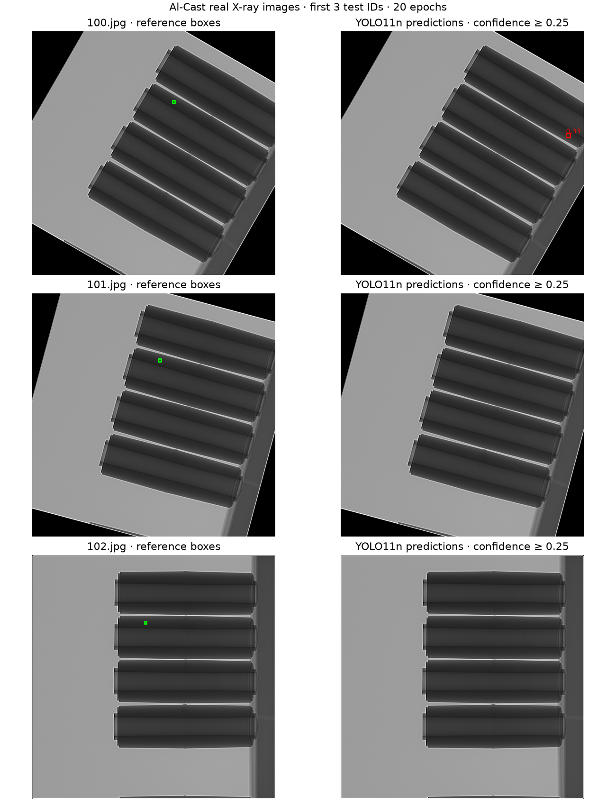
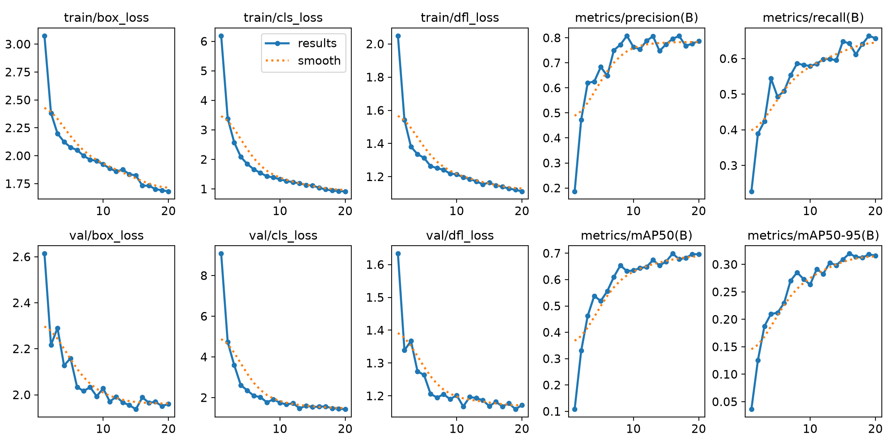

# 工业 X 光缺陷检测

使用 YOLO11n 在 Al-Cast 真实铝铸件 X 光图上训练，定位内部缺陷。当前完成数据检查、训练、验证、测试和预测图导出。

## 真实测试结果

2026-11-05 完成 20 轮训练，输入 640×640，批大小 8，Apple Silicon MPS。COCO 预训练初始化，将原始缺陷类型合并为一个 defect 类。最佳权重按验证集 mAP@0.50:0.95 选择。

| 数据集合 | 图像 |
| --- | ---: |
| 训练 | 2,186 |
| 验证 | 684 |
| 测试 | 596 |

测试集共 985 个缺陷框。

| 测试指标 | 结果 |
| --- | ---: |
| mAP@0.50 | 68.28% |
| mAP@0.50:0.95 | 30.12% |
| 精确率 | 74.14% |
| 召回率 | 60.61% |

精确率与召回率来自 Ultralytics 评估器的汇总工作点。预测展示采用固定置信度 0.25。小缺陷仍有漏检，严格 IoU 下的框定位精度还有较大改善空间。

[原始指标](artifacts/alcast-yolo/test-metrics-20e-640.json) · [训练逐轮记录](artifacts/alcast-yolo/training.csv) · [划分检查](artifacts/alcast-yolo/split-audit.json)

## 真实图像效果

下图固定采用测试集中编号最前的三张图。左列绿色框为发布数据标注，右列红色框为实际模型预测，数字为置信度。这三张包含明显漏检，100.jpg 还出现偏离标注的预测框。



图像来自 Al-Cast，由本项目脚本叠加标注和模型输出。数据出处为 Parlak 与 Emel 的研究及作者公开下载包。[论文](https://doi.org/10.1016/j.engappai.2022.105636) · [下载入口](https://drive.google.com/drive/folders/1e5kPSc1RuapBtF5zMW5HhoTYVjttjdJ7)



## 数据检查与评估限制

发布包共 3,466 张图和 3,024 份标注文件，包含 5,809 个缺陷框。未提供框的图像按无标注异常处理。坐标检查未发现非法框。

原来的划分发现 47 次完全相同 JPEG 跨集合重复。本次将每 50 个连续编号视为一个组，再将共享相同 JPEG SHA256 的组归并后划分，跨集合完全重复数为零。各组明细保存在固定的 split.json 中。真实零件身份和近重复关系仍待核实，因此该划分用于项目内部评估。

早期 3 轮、512 像素试跑的 mAP@0.50 为 36.69%，原始划分存在上述重复问题。本次同时调整训练轮数、分辨率和划分，两个数值不能用于隔离某一项调整的收益。训练超参数与模型选择均使用训练、验证集合，测试集用于训练完成后的最终评估。

[固定划分](artifacts/alcast-yolo/split.json) · [早期试跑指标](artifacts/alcast-yolo/test-metrics.json)

## 复现

使用 Python 3.12、Ultralytics 8.4.0。先从作者入口取得 AlCastXray.zip，存为 data/AlCast.zip。实测包 SHA256 为：

```text
80dafea2764d8a1467d3ae831af4d5278028a5f12c9d5ff870db08e5ff4bedf5
```

```sh
uv venv --python 3.12 .venv-yolo
uv pip install --python .venv-yolo/bin/python -r requirements-yolo.txt
mkdir -p data/yolo
curl -fL https://github.com/ultralytics/assets/releases/download/v8.3.0/yolo11n.pt -o data/yolo/yolo11n.pt
PYTORCH_ENABLE_MPS_FALLBACK=1 .venv-yolo/bin/python scripts/train_alcast_yolo.py data/AlCast.zip --epochs 20 --imgsz 640 --batch 8
```

训练结束自动评估测试集并输出 test-metrics-20e-640.json。权重与完整运行结果保存在 data/yolo 下，每次运行可能自动追加目录编号。此次最佳权重为 data/yolo/train_dedup_20e_6402/weights/best.pt，保留在本地。

```sh
.venv-yolo/bin/python scripts/export_yolo_results.py data/yolo/train_dedup_20e_6402/weights/best.pt
python3 -m unittest discover -s tests -v
```

无 MPS 的环境可传入 --device cpu。随机种子固定为 42，MPS 部分运算仍有非确定性提示，重跑指标可能有差异。

## 早期算法记录

残差 MAD 算法仍保留在 src/prototype.py，原输入要求已配准的正常参考图。合成演示可通过下列命令执行。

```sh
python3 src/prototype.py --output artifacts
```

早期 PyXVis 小图分类和 Al-Cast 线性评分器记录保留在 artifacts 中，当前主流程为 YOLO 框检测。

[原型范围](docs/IMPLEMENTATION.md) · [验证记录](docs/VALIDATION.md) · [真实数据来源](docs/REAL_DATA.md)
