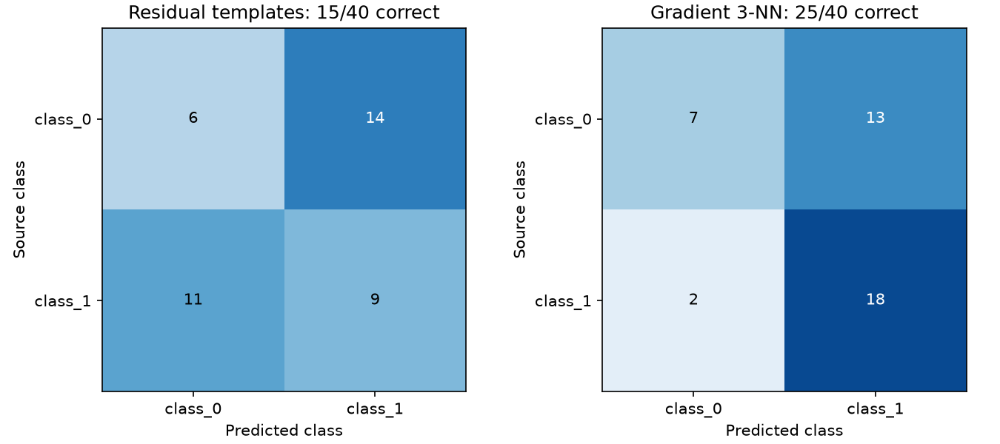

# X 光异常区域基线

## 真实数据实测（2026-11-04）

已下载并实际运行作者 [PyXVis](https://github.com/computervision-xray-testing/pyxvis) 仓库的铸件 X 光 JPEG 小图。README 以这次真实数据测试为主；合成样例仅保留作回归检查。

**同一批 40 张测试图上，梯度 3 近邻判对 25 张（62.5%），残差双模板判对 15 张（37.5%）。**

| 项目 | 实测设置 / 结果 |
| --- | --- |
| 来源版本 | `30de3af0edee237ac3fb7838a14d9f156a7e2fa5` |
| 数据 | 作者 `listings/images/castings/` 下的真实铸件小图，32×32 灰度 |
| 选样 | 源 train/test 各按类别、文件名字典序取前 20 张 |
| 训练 / 测试 | 40 / 40 张；各含 20 张 class_0 与 20 张 class_1 |
| 方法 | 每类训练图取逐像素中位数模板，调用残差 MAD 打分，分数截断至 20 后取均值，选距离较小的类别 |
| 固定参数 | 异常阈值 5；未利用测试标签调参 |
| 梯度 3 近邻 | 将灰度梯度幅值按 4×4 网格取均值并归一化，用距离最近的 3 张训练图投票 |
| 梯度 3 近邻准确率 | 62.5%（25/40） |
| 残差双模板准确率 | 37.5%（15/40）；平衡二分类随机猜测期望为 50% |
| 缺陷定位精度 | 未评测：本次小图未取得像素真值和成对正常参考 |



行是真实类别，列是预测类别。梯度法判对 7/20 张 class_0 和 18/20 张 class_1，类别表现仍不均衡。这里保留作者目录的 class_0/class_1 编号，其正常/缺陷含义尚未独立核实，因此不报告缺陷召回或正常误报率。样本量小、按名字选取，没有完成按原始零件或采集系列去重，不能作为完整数据集或现场泛化结论。

## 查看真实图像与输出

运行脚本后，本地 [真实输入与输出对照图](data/real-data-preview.png) 展示四张真实输入、相对于 class_0 模板的异常掩膜与分数。它们是未配准小图的探索性输出，不能视为已验证的缺陷位置。

[GDXray 官方数据说明](https://github.com/computervision-xray-testing/GDXray)限制科研教育使用、禁止再分发及商业使用。本仓库保守地不上传原图和含原图的本地效果图；上方公开图仅展示汇总统计。每个实际下载文件的来源 URL、SHA256、尺寸和逐图结果见 [实测报告](artifacts/real-data/report.json)。

## 复现真实数据测试

Python 3.11+，另需系统 `curl`。首次运行下载固定清单的 80 张小图到被 Git 忽略的 `data/pyxvis/`，不会下载完整 Castings 压缩包。

```sh
python -m pip install -r requirements.txt
python scripts/validate_real_data.py
python -m unittest discover -s tests -v
```

输出：

- `artifacts/real-data/report.json`：数据来源、校验值、方法参数与逐图测试结果。
- `artifacts/real-data/summary.png`：真实小图类别混淆矩阵。
- `data/real-data-preview.png`：本地真实输入与算法输出对照。

下载清单固定在 `scripts/real_data_paths.json`，训练与测试沿用源目录划分。测试脚本不注入人工缺陷。

## 当前算法与限制

`src/prototype.py::process(image, reference)`输出残差 MAD 异常掩膜与分数。其原始输入契约要求同尺寸、已配准的灰度图与正常参考图。

此次新增的双模板类别实验使用类别中位数模板，是为了检验这类残差分数在真实小图上的表现；这些模板不满足“同零件成对正常参考”的条件。因此该实验不构成原始成对检测算法的正式验收，当前也没有训练目标检测网络。下一步应建立正常/缺陷标签映射与零件级拆分，选用合适的真实数据分类/定位基线，并继续等待现场成对参考数据。

## 数值有效性与阈值

`process(image, reference, threshold=5.0)` 要求二维、非空、同形状且有限的输入。阈值必须为有限的正标量；NaN、无穷、零、负值或向量均抛出 `ValueError`。即使输入有限，极端数值也可能使残差或评分溢出，此时明确拒绝计算，避免无效分数被当成“没有异常”。需在调用前对图像和参考使用相同尺度进行合理缩放。

评分为 `abs(residual - median(residual)) / max(1.4826 * MAD, 1e-8)`；仅 `score > threshold` 判为异常，等于阈值不标记。MAD 为零时使用固定尺度下限，结果依赖输入灰度尺度。整体恒定偏移会被残差中位数消除，因此本方法不能检测全图统一亮度偏移。

## 合成回归检查

```sh
python src/prototype.py --output artifacts
```

原 `artifacts/result.png`、`metrics.json` 和 `results.npz` 仍来自固定种子合成样例。它们仅检查数值流程，没有替换为真实检测指标。

[真实数据说明](docs/REAL_DATA.md) · [验证记录](docs/VALIDATION.md) · [实现范围](docs/IMPLEMENTATION.md) · [PRD](docs/PRD.md)
