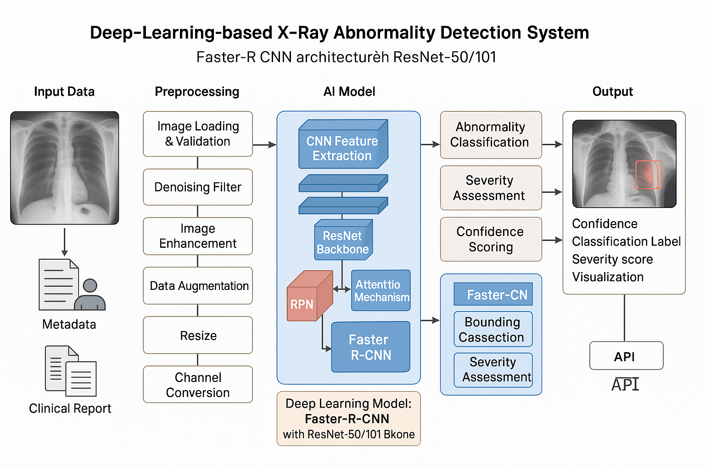

# X 光图像异常检测：产品需求文档

## 目标与当前阶段

围绕 X 光图像组织预处理、目标检测与结果可视化，研究异常区域的定位方法。

本阶段从零开发可运行原型。网站历史介绍用于确定问题与方向，不作为已实现能力或性能证据。原型需要独立运行，并提供可重复的输入、输出和验证步骤。

## 使用者与场景

面向需要验证X光图像流程的开发者和研究人员。使用者应能准备输入、执行一次完整处理、查看结果，并导出可复核记录。

## 技术范围

- X光图像：实现输入检查、核心处理与可观察输出。
- 目标检测：实现输入检查、核心处理与可观察输出。
- 计算机视觉：实现输入检查、核心处理与可观察输出。

## 用户流程

1. 按说明安装依赖并检查运行环境。
2. 使用仓库附带的确定性样例验证环境；样例必须标记为合成或模拟数据。
3. 载入自有输入，校验类型、尺寸、单位和取值范围。
4. 执行核心处理，显示中间状态与错误原因。
5. 查看结果和可视化，导出配置、输出、日志与运行环境。

## 输入与输出契约

输入须包含数据来源、单位及必要配置；缺失字段应明确报错。输出须包含处理结果、配置快照与运行状态。硬件断开、数据为空、格式不支持和数值异常不得伪装为成功。

## 原型交付要求

- 可直接执行的实现代码与固定版本依赖。
- 独立的最小样例、运行命令和输出说明。
- 针对核心计算与异常输入的验证。
- 实际运行生成的结果图或界面截图。
- 架构示意与运行截图分开存放，注明来源。

## 验收标准

- 全新环境按 README 可复现样例运行。
- 相同输入与配置产生一致结果，随机流程固定种子。
- 关键参数影响可通过对照样例观察。
- 非法输入返回明确错误，不产生误导性结果。
- 测试与截图均来自当前实现，记录运行命令。

## 边界与待验证项

真实设备接入、现场数据泛化、吞吐量、精度和长期稳定性需单独验证。依赖模型权重、标注数据、硬件驱动或第三方 SDK 的能力，在未接入前应列为待完成；合成演示不证明真实场景效果。

## 实施顺序

1. 明确数据结构与最小可验收场景。
2. 实现核心流程和命令行入口。
3. 补充交互展示、导出与错误处理。
4. 执行验证、生成运行截图并记录限制。
5. 审阅公开内容后推送。

## 现有参考图示

以下图示来自个人网站，为历史架构或概念说明，不能代替当前原型运行截图。

